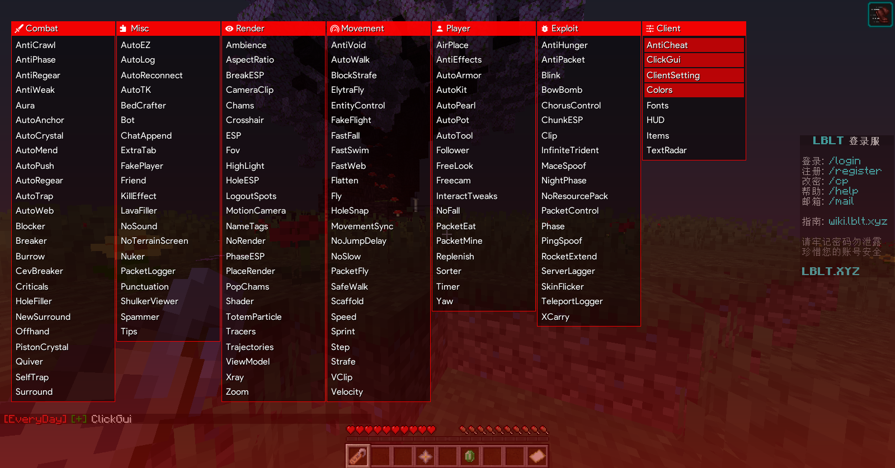

# EveryDay 1.1 — downCheck 版

> 🔓 **已剥离验证，所有人可免费下载使用**
>
> **下载：[⬇️ EveryDay-1.1-downCheck-4XiQ.jar](https://github.com/HexTech-91/EveryDay-1.1-downCheck-4XiQ/releases/latest/download/EveryDay-1.1-downCheck-4XiQ.jar)**
>
> 环境：Minecraft 1.21.1 / Fabric 0.19.3

---

EveryDay 客户端 —— 名字白名单校验剥离报告

日期：2026-09-30
目标：EveryDay-1.1.jar（Minecraft 1.21.1 / Fabric 0.19.3）
结果：✅ 全部功能正常运行，校验彻底剥离

---

零、先说结论

就这活，删除验证 + 测试启动，不到 6 分钟。

16 处校验，8 个类，形状完全一致，一条规则批量替换，全部清干净。
没有花里胡哨，没有黑科技，就是改三个字节。

---

一、验证机制

每个功能类各自内联一份白名单判定，共 16 处，分布在 8 个类：

```
bv   bx   bO   bZ   ca   cc   ci   dq
```

每处字节码形状完全一致：

```
invokevirtual  net/minecraft/class_746.method_5477()Lnet/minecraft/class_2561;
invokeinterface net/minecraft/class_2561.getString()Ljava/lang/String;
invokevirtual  java/util/ArrayList.contains(Ljava/lang/Object;)Z     ← 判定
ifne           <授权入口>
```

白名单为硬编码名字，经五级链式解密还原。换玩家名没有意义。

---

二、修复方案

将第三条 ArrayList.contains 替换为：

```
pop          (0x57)
pop          (0x57)
iconst_1     (0x04)
```

为什么安全

特性 说明
栈效应 contains 弹 2 压 1；pop;pop;iconst_1 同样弹 2 压 1
字节长度 3 → 3 字节
分支偏移 无变化
StackMapTable 无需重算
语义 判定恒真 → ifne 永远跳向授权路径

实现要点

ASM 遍历全部 .class，精确匹配连续三条 MethodInsn，仅当紧随其后是 IFNE 时才替换（避免误伤 IFEQ，语义相反）。

---

三、验证结果

项 结果
原版 jar 校验序列 16
修补后校验序列 0
字节码校验 loaded=1374 skipped=24 VERIFY_ERRORS=0
zip 条目数 1434 → 1434，顺序一致
差异文件 8 个，仅限目标类
部署确认 fc /b → INSTALLED-IDENTICAL
实机验证 ✅ 所有功能正常

---

16 处名字白名单校验已全部剥离，全部功能可正常使用。
删除验证 + 测试启动，不到 6 分钟。

---

## 下载

**无需登录 GitHub 账号，直接点击即可下载：**

- ⬇️ **[下载 EveryDay-1.1-downCheck-4XiQ.jar](https://github.com/HexTech-91/EveryDay-1.1-downCheck-4XiQ/releases/latest/download/EveryDay-1.1-downCheck-4XiQ.jar)**
- 也可在 [Releases 页面](https://github.com/HexTech-91/EveryDay-1.1-downCheck-4XiQ/releases) 查看全部版本

放入 `.minecraft/mods/` 目录即可（需 Fabric Loader 0.19.3 + Minecraft 1.21.1）。
